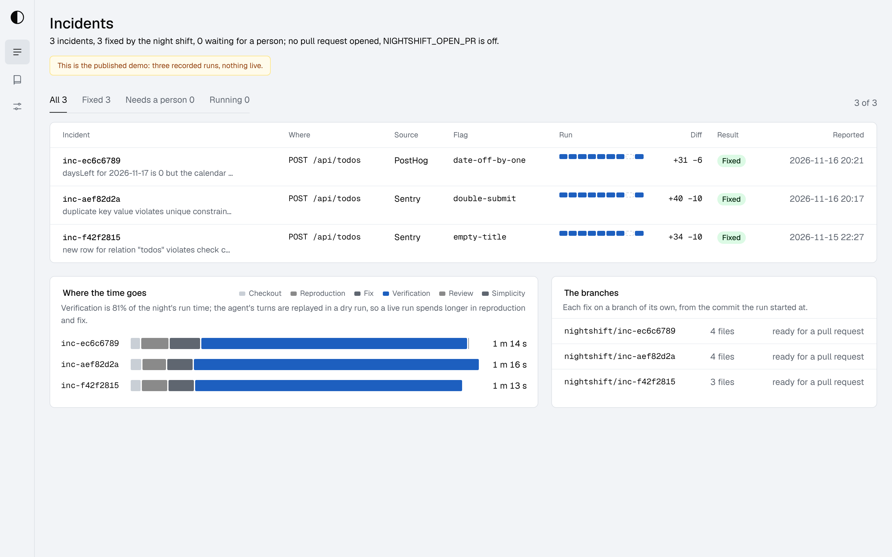
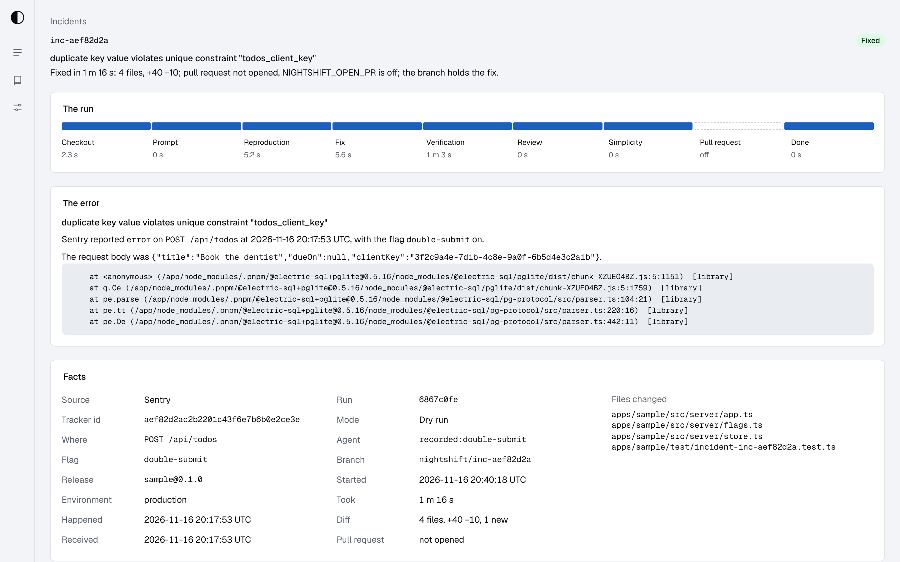

# Nightshift

An on-call engineer that never sleeps. An error arrives from the error tracker (a Sentry or PostHog webhook); Nightshift turns it into a reproduction, hands it to a coding agent in a checkout of its own, requires a failing test before any fix, runs the fix through the app's verification scenarios and two review gates, and opens a pull request. A dashboard shows every incident from the error to the pull request body.

I built it as a reference implementation of a way of working, with a deliberately small app to look after. It is a project to read and run, and the limits are at the end.



Live demo: https://nightshift-francesco-saponaro.netlify.app. The demo is the dashboard built against the three recorded runs in `fixtures/`; nothing in it is live, and the settings page says so.

## What happens when an error comes in

1. The webhook. `POST /webhooks/sentry` or `POST /webhooks/posthog` on `apps/agent`. The signature is checked over the raw bytes with the integration's secret before the body is parsed; a delivery is refused when no secret is configured, and each address gets sixty deliveries a minute. The payload is validated with zod and becomes an incident: title, culprit, request, stack, release, and the seeded-bug flag that was on when it happened. The same event delivered twice is one incident.
2. The queue. The incident goes on a pg-boss queue in the same database as everything else (PGlite in memory by default, PGlite on disk or PostgreSQL by `DATABASE_URL`), so a restart loses nothing and two workers never take the same run.
3. A checkout of its own. The worker makes a git worktree on a new branch, installs dependencies there, and puts the skills on the agent's path. The main checkout is never touched.
4. The prompt. Three sections, filled from the incident: Goal, Context, Validation and verification scenarios. The template is `packages/skills/skills/prompt.md`; each fixture's `prompt.md` is what the agent got.
5. A failing reproduction first. The agent is asked for one thing: a unit test named after the incident, with the incident's flag on, and nothing else. The runner runs it and requires it to fail with a real test failure (a crash or a missing file does not count). If it passes, the run stops: there is nothing to fix.
6. The fix. The agent fixes the cause with the smallest diff. The runner runs the reproduction again and requires it to pass.
7. Verification. The sample app's unit tests, the Playwright scenarios with the flag on and with it off, the typecheck and the lint, in that order, in the worktree. One failure stops the run.
8. Two gates. The review skill and the simplicity skill, each in two halves: the lines a program can check on the diff (a reproduction exists, no dependency or config touched, no test weakened, no constraint dropped, no sleep or in-memory state, no secret, no rename, no file over 200 lines, the flag retired) and the lines a reader judges (the agent applies the skill to its own diff and ends with a verdict line). A refusal goes back to the agent once; a second refusal stops the run for a person.
9. The pull request. The agent's edits are committed on the branch (Nightshift's own skills are left out), the branch is pushed, and `gh` opens a pull request under the `nightshift` label with a body written from the run's own events: the incident, the reproduction's failing output, the files, every verification command with its time, both verdicts, and whatever the agent noted under "Seen, not touched". This step is off unless `NIGHTSHIFT_OPEN_PR=1`; off, the run records the title and body it would have used and leaves the branch in its worktree. Auto-merge needs `NIGHTSHIFT_AUTO_MERGE=1` as well, and then GitHub merges when the checks are green.

Every step leaves an event on the run, in order, redacted of keys, tokens, cookies and addresses. Each fixture's `events.json` is the full record of one run and `pr.md` the pull request it wrote.

## Dry run and live run

There is no API key in this repository and none is needed to run it. Without `ANTHROPIC_API_KEY`, Nightshift runs in dry-run mode: the agent's turns are replayed from a recorded transcript in `fixtures/` and its edits are applied as patches. Everything else runs for real: the worktree is created, the reproduction runs and has to fail, the fix has to make it pass, the verification scenarios run in a browser, the gates read the diff, the pull request body is written. The mode is on `/health`, in the log, on every run and on the dashboard.

With `ANTHROPIC_API_KEY` set, the agent is the live one, driven through the Claude Agent SDK (`@anthropic-ai/claude-agent-sdk`), one session per run, working inside the worktree with the skills loaded as project skills. The key is read by the SDK from the environment and by nothing in this repository; it is never logged, and the transcript is redacted before it is stored.

The three fixtures were made without a key. Each webhook payload is real: two came out of the sample app's reporter (Sentry's shape) with a bug switched on, and one came out of the sample's web client in a real browser (PostHog's `$exception` shape) when the server's day count disagreed with the calendar. The prompts are the builder's output. The transcripts are authored to match the code paths exactly, and each says so in its first line; the patches are what the agent's edits amount to; the verification logs, the events and the pull request bodies are from real dry runs of the whole pipeline.

## The dashboard

`apps/dashboard` is a Vite + React app over the agent's read API, with TanStack Router and Query and Tailwind. Four screens: the incidents, with each run drawn as a strip of its steps, where the night's time went and the branches left behind; one incident from the error to the pull request body, with the agent's transcript, the verification table and both verdicts; the skills as the agent reads them, with what the runner checks on each; and the settings, with every integration and every variable. `VITE_DEMO=1` builds it against the fixtures, which is what the live demo is.



## The sample app

`apps/sample` is the app Nightshift looks after: a to-do list with a Fastify API over a PostgreSQL-shaped store (PGlite), a React front built with Vite, unit tests in `test/` and Playwright scenarios in `verification/`. It ships with three bugs behind flags, so a demo can make it fail for real:

| Flag | What goes wrong | Where |
| --- | --- | --- |
| `empty-title` | An empty title is not refused at the edge; the database constraint rejects it and the API answers 500 instead of 400. | `src/server/app.ts` |
| `date-off-by-one` | Days until a due date are counted from the current time instead of from the start of the day, so after midday a to-do due tomorrow says "due today". | `src/server/dates.ts` |
| `double-submit` | Creating a to-do checks for the client key and then inserts, in two steps; two requests at once both pass the check and the second one fails on the unique index with a 500. | `src/server/store.ts` |

Each flag marks the code path that shipped the bug. The fix a run produces removes that path and marks the flag's entry in `flags.ts` with the incident that retired it, so the flag is still accepted and now does nothing. The tests that document each symptom go through the app, so they still compile once a fix has removed a branch and its argument, and they step aside once the entry is marked; the reproduction test named after the incident takes over.

Every 500 the app answers goes to a reporter. With `SAMPLE_REPORT_URL` set, the reporter posts a Sentry-shaped event, signed with `SENTRY_CLIENT_SECRET` the way Sentry signs its own, to that URL, so the whole loop runs on one laptop with no Sentry account. The web client checks the server's day count against the calendar and hands a disagreement to the error tracker's browser SDK when one is loaded, which is how a bug that throws nothing still becomes an incident.

## Run it

```
pnpm install --frozen-lockfile
pnpm test                                      # every package, about four minutes; three of the tests are whole pipeline runs in dry-run mode
pnpm -C apps/sample test:e2e                   # the verification scenarios, in a browser, bugs off
SAMPLE_BUGS=empty-title pnpm -C apps/sample test:e2e   # the same, with one bug on: its scenario fails
pnpm -C apps/agent run-fixture empty-title     # the pipeline on a recorded incident, with the full verification
pnpm -C apps/agent run-fixture double-submit --quick --keep   # unit tests only, and leave the worktree to look at
pnpm -C apps/agent run-fixture date-off-by-one --pr          # also push the branch and open the pull request (gh signed in)
```

To run the server, the worker and the dashboard:

```
cp .env.example .env            # fill in what you have; nothing is required for the dry run
pnpm -C apps/agent dev          # http://127.0.0.1:4000, webhooks and the read API
pnpm -C apps/dashboard dev      # http://localhost:5173, the dashboard, reading the agent through /api
pnpm -C apps/sample dev         # http://127.0.0.1:3000, the to-do app
```

Point the sample app at Nightshift with `SAMPLE_REPORT_URL=http://127.0.0.1:4000/webhooks/sentry`, give both the same `SENTRY_CLIENT_SECRET`, switch a bug on with `SAMPLE_BUGS`, use the app, and watch the run on the dashboard. `pnpm test:e2e` needs a Chromium that Playwright can find; `pnpm -C apps/sample exec playwright install chromium` gets one. `VITE_DEMO=1 pnpm -C apps/dashboard build` makes the demo build.

## Running it against your own app

Nightshift knows the sample app by name in four places, and that is the list to change: the verification commands in `apps/agent/src/pipeline/run.ts` (`DEFAULT_VERIFICATION`), the reproduction path and the flag convention in `apps/agent/src/pipeline/prompt.ts` and `gates.ts`, the project folder the worktree is made from (`findRepo` in `cli.ts` and `main.ts`), and the words in `packages/skills/skills/verify.md` about how to run the app. The webhooks, the queue, the worktree, the phases, the gates' parsing and the pull request step do not care what the app is.

## The seven practices and where each one lives

| | Practice | Where |
| --- | --- | --- |
| 1 | Verification skills that teach the agent how to run and test the app | `packages/skills/skills/verify.md`, `apps/sample/verification/` |
| 2 | Agents that write, test and merge without a person reading the diff, with quality enforced by skills | `apps/agent/src/pipeline/run.ts`, `apps/agent/src/pipeline/gates.ts`, `apps/agent/src/pipeline/pr.ts` |
| 3 | Agents in their own environment, one per task | `apps/agent/src/pipeline/worktree.ts` (`NIGHTSHIFT_SANDBOX_URL` is read for a cloud sandbox and, for now, unused) |
| 4 | The 24/7 on-call engineer wired to Sentry and PostHog | `apps/agent/src/webhooks/`, `apps/agent/src/queue.ts` |
| 5 | Code-quality skills before every pull request | `packages/skills/skills/review.md`, `react.md`, `simple.md` |
| 6 | The three-section prompt | `packages/skills/skills/prompt.md`, `apps/agent/src/pipeline/prompt.ts` |
| 7 | A documented setup | this file, `.env.example`, the dashboard's settings screen, `fixtures/README.md` |

## Layout

```
apps/sample/        the to-do app: src/server (Fastify, PGlite), src/web (React), test/, verification/
apps/agent/         the runner: webhooks, queue, store, pipeline/ (worktree, prompt, run, gates, pr), agent/ (recorded and live), cli.ts, main.ts
apps/dashboard/     the dashboard: src/api (server and demo), src/screens, src/timeline.ts
packages/skills/    the skills as markdown, and a loader
fixtures/           three recorded incidents: webhook, prompt, transcript, patches, verification log, events, pull request
docs/screenshots/   the two pictures above
```

## Tests

`pnpm test` runs every package's Vitest suite: the sample app's API, store, dates and reporter; the skills loader; the agent's parsers, signature check, gates, prompt builder, pull request body and step, configuration, store and read API; the dashboard's demo data, timeline and screens against the recorded runs; and `apps/agent/test/pipeline.test.ts`, which runs all three fixtures through the whole pipeline on a real worktree of this repository, with git and `gh` stood in for on the one run that opens a pull request, so nothing leaves the machine. `pnpm -C apps/sample test:e2e` runs the six verification scenarios in Chromium. The CI workflow runs the lint, the typecheck, the tests, the builds, and the scenarios with the bugs off and once with one bug on, where the run must fail.

## Known limits

- The transcripts in the fixtures are authored, not recorded from a live session, because no key was available where they were made. The fixtures README will say "recorded" only when one is.
- The review gates' second half is the agent judging its own diff with the skill. In dry-run mode that judgement is the fixture's. A second reviewer session is a natural next step.
- The rework loop (a gate refused once, the agent gets the findings back) is in the code and has no fixture that exercises it.
- The race in `double-submit` is reachable because the store waits a few milliseconds before each query to behave like a database over a socket; PGlite itself answers inside the same tick.
- The pull request step is tested against a local bare repository and a stand-in `gh`; it has not been run against GitHub from this repository.
- `NIGHTSHIFT_SANDBOX_URL` is read and does nothing yet; every run is a git worktree on the machine Nightshift runs on, which means the agent's commands run there too.
- The human still reads the pull request title. Auto-merge is behind a flag and off by default, and will stay so.
